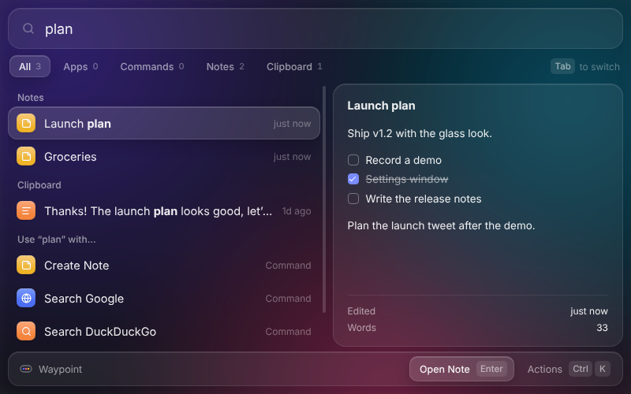
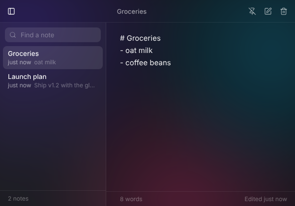

# Open Palette

[](https://github.com/alexsilver8/open-palette/actions/workflows/ci.yml)
[](https://github.com/alexsilver8/open-palette/releases)
[](./LICENSE)
[](https://www.conventionalcommits.org)

An open-source, keyboard-first launcher for macOS, Windows and Linux, in the spirit of Raycast. Press <kbd>⌥</kbd> <kbd>Space</kbd>, type a few letters, press <kbd>↵</kbd>.



## What it does

- **Opens apps** — finds installed applications on every platform.
- **Keeps notes, as many as you want** — a floating Notes window with search, autosave and a pin to keep it on top. Every note is a plain Markdown file, so you can sync, back up or edit them with anything. There's no limit on how many you keep.
- **Calculates as you type** — `1200 * 1.077 + 2^5` shows `1,324.4`; <kbd>↵</kbd> copies it.
- **Remembers your clipboard** — searchable history of copied text, skipping anything password managers mark as private.
- **Searches the web** — anything that doesn't match falls back to Google, DuckDuckGo or any extension that offers itself.
- **Learns what you use** — frequently used items rise to the top.
- **Runs extensions** — commands written in JavaScript, each extension in a separate process. See [Writing extensions](docs/extensions.md).
- **Everything has actions** — <kbd>⌘</kbd> <kbd>K</kbd> lists what you can do with the selected item.

## Install

Download the latest build for your system from [Releases](https://github.com/alexsilver8/open-palette/releases).

Builds aren't code-signed yet, so your system will warn you the first time you open one. On macOS, allow it under **System Settings → Privacy & Security → Open Anyway**. On Windows, choose **More info → Run anyway**.

## Use

| Keys | |
| --- | --- |
| <kbd>⌥</kbd> <kbd>Space</kbd> (<kbd>Alt</kbd> <kbd>Space</kbd>) | Open or close the launcher |
| <kbd>↑</kbd> <kbd>↓</kbd> | Move through results (also <kbd>Ctrl</kbd> <kbd>N</kbd> / <kbd>Ctrl</kbd> <kbd>P</kbd>) |
| <kbd>↵</kbd> | Run the primary action |
| <kbd>⌘</kbd> <kbd>↵</kbd> | Run the secondary action |
| <kbd>⌘</kbd> <kbd>K</kbd> | Show all actions |
| <kbd>Esc</kbd> | Go back, clear the search, then close |
| <kbd>⌘</kbd> <kbd>,</kbd> | Open settings |

In the Notes window: <kbd>⌘</kbd> <kbd>N</kbd> new note, <kbd>⌘</kbd> <kbd>P</kbd> find a note, <kbd>⌘</kbd> <kbd>\</kbd> show or hide the list, <kbd>⌘</kbd> <kbd>⇧</kbd> <kbd>⌫</kbd> move the note to the Trash.

On Windows and Linux, use <kbd>Ctrl</kbd> wherever you see <kbd>⌘</kbd>.

On Linux under Wayland, global shortcuts may not reach the app. Bind a shortcut in your desktop settings to run `open-palette` instead: launching it again opens the running instance.

## Notes



Run **Create Note** to start writing, **Search Notes** to find one from the launcher, or **Open Notes** to bring the window back. **Create Note** also appears under **Use “…” with** for anything you type, so you can type a thought into the launcher and save it straight away.

Notes are saved as you type, one `.md` file per note. Set `notesDirectory` to a synced folder (Dropbox, iCloud Drive, a git repo) to have them everywhere; Markdown files already in that folder show up as notes too. Notes you delete go to the system Trash.

## Settings

Run **Open Settings** to edit `settings.json`. Changes apply as soon as you save.

```jsonc
{
  "hotkey": "Alt+Space",              // any Electron accelerator, e.g. "CommandOrControl+Shift+Space"
  "hideOnBlur": true,                 // close when you click elsewhere
  "launchAtLogin": false,             // macOS and Windows
  "theme": "system",                  // "light" or "dark"
  "clipboardHistory": { "enabled": true, "maxItems": 200 },
  "extensionDirectories": [],         // more places to load extensions from
  "notesDirectory": ""                // where notes are saved; empty means the app's data folder
}
```

## Develop

You need Node.js 22.12 or later and pnpm (`corepack enable` sets up the right version).

```sh
pnpm install
pnpm dev          # run with hot reload; also loads examples/extensions
pnpm test         # unit tests
pnpm test:e2e     # build, then drive the app with Playwright
pnpm lint         # Biome
pnpm typecheck
pnpm dist         # installers for your OS in release/
```

`pnpm install` also downloads the Electron binary for your platform.

### How it fits together

```
┌──────────────────────┐  IPC   ┌────────────────────────────┐  messages  ┌─────────────────────┐
│ Renderer (React)     │◀──────▶│ Main process               │◀──────────▶│ Extension host      │
│ search, ranking,     │        │ window, hotkey, tray,      │            │ (utility process)   │
│ calculator, actions  │        │ apps, clipboard, built-in  │            │ third-party         │
│                      │        │ commands, command registry │            │ extensions          │
└──────────────────────┘        └────────────────────────────┘            └─────────────────────┘
```

- `src/main` — app lifecycle, the launcher window, built-in commands (`commands/`), app indexing (`apps/`), clipboard history, notes (`notes/`) and the command registry that routes every action.
- `src/extension-host` — loads extensions and runs their commands in a separate process.
- `src/renderer` — the launcher and Notes windows. Root search and the calculator run here, so typing never waits on IPC.
- `src/shared` — types, fuzzy matching and the calculator, shared by all three.

Built-in commands implement the same interface as extensions, so anything a built-in can do, an extension can too.

## Roadmap

- Detail (markdown) and form views for extensions
- An `@open-palette/api` package with types and helpers
- Markdown preview and checklists in Notes
- Quicklinks and snippets
- Window management
- A settings screen, including recording the hotkey
- Code-signed, auto-updating releases

Ideas and bug reports are welcome in [Issues](https://github.com/alexsilver8/open-palette/issues).

## Contributing

Contributions are welcome! Please read [CONTRIBUTING.md](./CONTRIBUTING.md) before opening a pull request.

## License

[MIT](./LICENSE)
